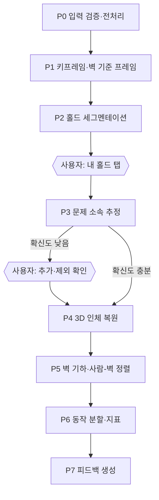
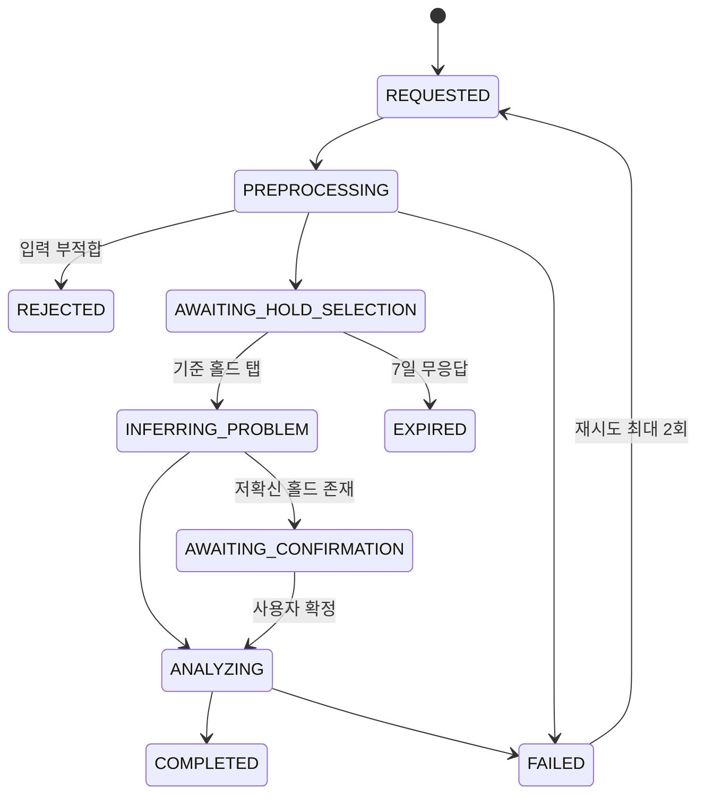

# 기능 명세서

> 🧭 기능은 업로드 → 홀드 확정 → 분석 → 피드백 → 비교 순으로 이어지며, 분석 작업은 사용자 입력을 기다리며 멈췄다 재개되는 상태 머신이다. 요구사항 ID는 요구사항 정의서와 같다.

## 1. 영상 업로드·검증 (FR-02, FR-03)

- 클라이언트가 업로드 URL을 받아 스토리지에 직접 PUT하고, 완료를 API에 알린다.
- API는 시도(Attempt)와 분석 작업(AnalysisJob)을 만들고 1차 처리(P0\~P2)를 큐에 넣는다.
- P0에서 카메라 흔들림, 60초 초과, 해상도 부족을 검사한다. 부적합하면 REJECTED와 반려 사유를 돌려준다.
- 같은 문제의 재시도라면 요청에 problemId를 함께 보낸다.

## 2. 홀드 인식과 문제 확정 (FR-04\~FR-07)

- 사람 마스크를 뺀 픽셀의 시간축 중앙값으로 사람 없는 벽 기준 이미지를 만든다.
- 홀드 세그멘테이션 모델로 모든 홀드에 ID·마스크를 붙이고, 작업은 AWAITING_HOLD_SELECTION에서 멈춘다.
- 사용자가 기준 홀드를 탭하면, 각 홀드의 마스크 내부와 가장자리 링의 Lab 색 분포를 기준 홀드와 비교한다.
- 초크·반사로 유효 색 픽셀이 부족한 홀드는 "보류"로 두고, 경계 확률 구간의 홀드만 사용자에게 확인받는다.
- 탐지 누락 홀드는 탭 한 번으로 SAM 2가 영역을 분리해 추가한다.
- 확정 결과는 Problem의 홀드 집합과 시작·종료 홀드로 저장되고, 같은 촬영 위치의 재시도에 재사용된다.

## 3. 분석 파이프라인 (FR-08\~FR-10)



| 단계 | 출력 | 방법·모델 | 실패·저확신 처리 |
| --- | --- | --- | --- |
| P0 입력 검증 | 정규화 영상 | ffmpeg, 배경 프레임 차분으로 카메라 고정 검사 | 즉시 반려하고 재촬영 가이드 |
| P1 키프레임·벽 기준 | 키프레임 목록, 벽 기준 이미지 | 선명도 필터, 시간축 중앙값 합성 | 끝까지 가려진 벽 영역은 "관측 없음" |
| P2 홀드 세그멘테이션 | 홀드 ID·마스크 | YOLO 계열 인스턴스 세그멘테이션 + SAM 2 경계 보정 | 누락은 사용자 탭으로 추가 |
| P3 문제 소속 | 홀드별 소속 확률 | Lab 색 분포, 초크·반사 비율, 다중 프레임 관측 | "보류" 또는 사용자 확인 |
| P4 3D 인체 복원 | 프레임별 3D 관절·인체 메시, 체형 추정, 사람 마스크 | SAM 3D Body(10fps 샘플링 후 보간) + 시간축 스무딩. 2D 포즈는 폴백 | 저신뢰 구간은 2D 폴백 또는 지표에서 제외 |
| P5 벽 기하·사람-벽 정렬 | 벽 깊이·normal·경사, 홀드 돌출, 사람-벽 공통 좌표 | 벽 기준 이미지 1장에만 Marigold V2 + MoGe-2(화각·실측 스케일), 접촉 지점 기반 스케일·시프트 추정 | 접촉 3개 미만이면 MoGe-2 실측 깊이로 폴백, 잔차 초과 시 공간 지표 보류 |
| P6 동작 분할·지표 | 접촉 이벤트, 무브 목록, 실패 지점, 지표 | 관절이 홀드 마스크 안에 N프레임 이상이면 접촉, 분절 질량 모델로 추정 무게중심 | 모든 수치에 신뢰도 부여 |
| P7 피드백 | 실패 원인 후보, 다음 동작 2\~3개 | 규칙 기반 후보 생성·순위화 후 LLM 문장화 | 근거 지표 없는 문장 금지 |

**사람-벽 정렬 (C안):** 벽은 움직이지 않으므로 깊이는 벽 장면당 한 번만 추정하고, 같은 촬영 위치의 재시도는 결과를 재사용한다. 벽 깊이는 P2와 함께 1차 작업에서 미리 계산할 수 있다. 사람은 3D 인체 복원으로 카메라 좌표의 3D 관절을 얻고, MoGe-2가 추정한 화각을 인체 복원 모델에 넣어 두 모델의 카메라 가정을 맞춘다. 손발이 홀드를 잡은 순간 그 위치는 홀드 표면 위에 있어야 하므로, 접촉 지점 집합 C에서 벽 log-depth의 스케일 a와 시프트 b를 맞춘다.

$$
(a, b) = \arg\min_{a,b} \sum_{c \in C} \rho\left(a\, d_{wall}(u_c) + b - \log z_c\right)
$$

u_c는 접촉 c의 이미지 좌표, z_c는 인체 복원 모델이 추정한 손발의 깊이, ρ는 이상치에 강한 손실(Huber)이다. Marigold V2 논문 5.1절의 희소 측정값 기반 스케일·시프트 추정과 같은 원리다.

## 4. 피드백·추천 (FR-11, FR-14)

- 리포트는 실패 지점, 원인 후보, 다음 동작 후보 2\~3개, 각 문장의 근거 지표로 구성된다.
- 추천은 현재 잡은 홀드, 문제 홀드 배치, 윙스팬 대비 리치 비율로 후보를 만들고 순위를 매긴다.
- LLM은 구조화된 사실만 입력받아 문장으로 바꾼다. 없는 사실을 만들지 않도록 문장마다 지표 ID를 달게 한다.
- 코치 검토는 동의·수정 여부와 코멘트를 별도 기록한다. 자동 피드백이 준비되지 않으면 코치가 같은 형식으로 직접 작성한다.

## 5. 시도 비교·이력 (FR-13, FR-15)

- 같은 Problem이면서 같은 촬영 위치(WallScene)인 두 시도만 비교한다.
- 비교 항목은 발 위치, 골반-벽 거리, 무브 순서, 실패 지점 변화, 제안 동작의 실제 시도 여부다.
- 다른 각도 영상 간 홀드 자동 매칭은 MVP에서 제외한다.

## 6. 분석 작업 상태 머신



같은 문제·같은 촬영 위치의 재시도는 확정된 홀드 집합이 있으므로 AWAITING 상태를 건너뛰고 바로 ANALYZING으로 간다.

## 7. API 명세

| 메서드 | 경로 | 용도 | 관련 요구사항 |
| --- | --- | --- | --- |
| PUT | /v1/me/body-profile | 키·윙스팬 등록·수정 | FR-01 |
| POST | /v1/videos/upload-url | 업로드 URL 발급 | FR-02 |
| POST | /v1/videos/{videoId}/complete | 업로드 완료 알림 | FR-02 |
| POST | /v1/attempts | 시도 생성 + 분석 요청 | FR-02 |
| GET | /v1/jobs/{jobId} | 작업 상태·다음 행동 조회 | FR-12 |
| GET | /v1/jobs/{jobId}/events | 진행 상황 SSE | FR-12 |
| GET | /v1/jobs/{jobId}/holds | 탐지된 홀드와 벽 기준 이미지 | FR-04 |
| POST | /v1/jobs/{jobId}/hold-selection | 기준 홀드 탭 전달 | FR-05 |
| POST | /v1/jobs/{jobId}/hold-confirmation | 홀드 추가·제외, 시작·종료 지정 | FR-06, FR-07 |
| GET | /v1/attempts/{attemptId}/report | 피드백 리포트 | FR-10, FR-11 |
| GET | /v1/attempts/{attemptId}/overlay | 오버레이 재생 데이터 | FR-08 |
| GET | /v1/problems/{problemId}/comparison?a=&b= | 두 시도 비교 | FR-13 |
| POST | /v1/attempts/{attemptId}/coach-reviews | 코치 검토 등록 | FR-14 |

모든 쓰기 요청은 Idempotency-Key 헤더를 받는다.

## 8. 워커 메시지 계약

작업은 `analysis.jobs`, 결과·진행 이벤트는 `analysis.events` 스트림으로 주고받는다. 큰 데이터는 스토리지 키로만 넘긴다.

```json
{
  "type": "RUN_PHASE",
  "jobId": "b8d2...",
  "phase": "PHASE_2",
  "attemptNo": 1,
  "input": {
    "videoKey": "videos/2026/09/abc.mp4",
    "wallSceneKey": "scenes/7f1.../",
    "problemHoldIds": ["h03", "h07", "h12"],
    "bodyProfile": { "heightCm": 172, "wingspanCm": 176 }
  },
  "pipelineVersion": "0.3.0"
}
```

```json
{
  "type": "PHASE_COMPLETED",
  "jobId": "b8d2...",
  "phase": "PHASE_2",
  "artifacts": {
    "poseKey": "artifacts/b8d2/pose.parquet",
    "bodyMeshKey": "artifacts/b8d2/body_mesh.npz",
    "wallDepthKey": "scenes/7f1.../depth.npy",
    "metricsKey": "artifacts/b8d2/metrics.json"
  },
  "report": { "failurePoint": { "frame": 842, "confidence": 0.71 } },
  "models": { "wallDepth": "marigold-v2", "wallGeometry": "moge-2", "body": "sam-3d-body" }
}
```

이벤트 종류는 PROGRESS, PHASE_COMPLETED, PHASE_FAILED 세 가지다.
