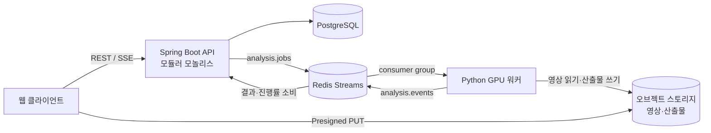

# 시스템 아키텍처

> 🏗️ Spring Boot 모듈러 모놀리스가 도메인과 DB를 소유하고, Python GPU 워커는 Redis Streams로 작업을 받아 결과 이벤트만 돌려준다. 워커는 DB에 직접 쓰지 않는다.

## 구성도

클라이언트는 영상을 스토리지에 직접 올리고, API는 작업만 만든다. 진행률과 결과는 워커 → 이벤트 스트림 → API → SSE 순으로 흐른다.

## 컴포넌트

| 컴포넌트 | 기술 | 책임 | 비고 |
| --- | --- | --- | --- |
| 웹 클라이언트 | React 계열 SPA | 업로드, 홀드 탭 선택, 오버레이 재생, 시도 비교 | MVP는 웹 기반 |
| API | Spring Boot 3, Java 21 | 인증, 도메인 로직, 작업 상태 전이, 결과 조회 | Clean Architecture(UseCase) 레이어 구조, 도메인별 패키지 경계 |
| DB | PostgreSQL | 도메인 데이터, 분석 지표(JSONB) | 관절 좌표 시계열은 스토리지 파일로 |
| 큐 | Redis Streams | 작업 전달, 결과·진행 이벤트, 재시도 | consumer group + PEL로 미처리 작업 회수 |
| 워커 | Python, PyTorch | P0\~P7 분석 파이프라인 | GPU 1장당 워커 1개, 동시 작업 1개 |
| 스토리지 | S3 호환(MinIO 또는 클라우드) | 원본 영상, 키프레임, 깊이 맵, 마스크, 포즈 시계열 | 수명 주기 정책으로 원본 삭제 기한 관리 |

## 설계 원칙

- **도메인은 모델을 모른다.** 도메인은 "깊이 맵", "홀드 마스크" 같은 결과 개념만 알고, 모델 이름은 워커 안에만 둔다.
- **확정할 수 없는 것은 확정하지 않는다.** 모든 AI 산출물에 확신도를 붙이고, 임계값 아래는 사용자 확인이나 "보류"로 보낸다.
- **분석은 비동기 작업이다.** 업로드 API는 즉시 응답하고, 사용자 확인 지점에서 작업이 멈췄다 재개된다.
- **중간 산출물을 재사용한다.** 벽 깊이·홀드 마스크는 같은 문제의 재시도에 다시 쓴다.
- **자동 분석과 사람 검토를 구분해 기록한다.**

## 설계를 좌우하는 기술 제약

| 제약 | 근거 | 설계 영향 |
| --- | --- | --- |
| 출력이 affine-invariant log-depth | Marigold V2 논문 3.1절 | 벽 기준 이미지 1장에만 쓰므로 프레임 간 정렬은 불필요. 사람 좌표와는 접촉 지점으로 스케일·시프트를 맞춘다 |
| 실측 거리 없음 | 논문 5.1절: 실측은 희소 측정값으로 스칼라 a, b를 추정 | 사용자 키를 스켈레톤 길이와 대조해 대략적 cm 스케일, UI에는 범위로 표시 |
| 1024×1024에서 약 1.9초·16.9GB | 논문 Tab. 6, 32GB GPU | 벽 장면당 1회만 실행(재시도는 재사용). Colab L4(24GB)로 처리 가능 |
| 2048×2048에서 약 9.6초·29.3GB | 논문 Tab. 6 | 2048로 벽을 추정하려면 32GB 이상(Colab A100 등) 필요 |
| 같은 레시피의 surface normal 모델 | 논문 5장 | 벽 경사와 홀드 면 방향 추정 옵션 |
| 베이스가 Qwen-Image-Edit-2509 | 논문 3.2절 | Marigold V2 가중치는 Apache 2.0으로 공개됨. 베이스 모델 라이선스는 별도 확인, 깊이 추정기는 교체 가능한 포트로 |
| 초크로 원래 색이 끝까지 안 보이면 복구 불가 | 기능 정리 문서 | 홀드 소속에 "보류" 상태를 명시 |
| 깊이 맵은 보이는 표면만 담고, 가려진 관절은 값이 없음 | 설계 검토 | 사람은 3D 인체 복원(SAM 3D Body)으로 분리해 가려진 관절과 3D 각도를 얻는다 |
| 일부 우수 모델이 상업 이용 불가 | GVHMR 라이선스, Video Depth Anything Base/Large(CC-BY-NC-4.0) | 후보에서 제외. Video Depth Anything은 Small(Apache 2.0)만 허용 |

**비용 추정:** Marigold V2는 벽 장면당 1회만 돌고(1024 기준 약 1.9초), 같은 촬영 위치의 재시도에서는 돌지 않는다. 프레임별 비용은 3D 인체 복원이 차지하며, 10fps 샘플링 후 보간을 기본으로 한다. 단계별 GPU 시간은 1\~2주차에 실측한다.

## 주요 결정

- **사람과 벽을 나눠 처리한다(C안):** 벽은 벽 기준 이미지 1장에 Marigold V2와 MoGe-2를 쓰고, 사람은 SAM 3D Body로 3D 복원한 뒤 접촉 지점으로 두 좌표계를 맞춘다. 최종 채택은 기술 검증 계획서의 A/B/C안 비교 결과로 확정한다.
- **GPU는 MVP 동안 빌려 쓴다:** 로컬 RTX 3070(8GB)으로 워커·포즈·세그멘테이션을 개발하고, Marigold V2는 Colab Pro(L4/A100)에서 돌린다. 이용자 테스트는 클라우드 GPU를 대여하고, 구매는 MVP 이후 실측 비용을 보고 판단한다.
- **큐는 Redis Streams:** 이미 쓰는 Redis로 ack·재전달·consumer group을 해결하고, MVP 처리량에 Kafka는 과하다. 커지면 작업 큐 포트 뒤에서 교체한다.
- **워커는 DB에 쓰지 않는다:** 상태 전이의 단일 소유자를 API로 두어 멱등 처리와 감사 기록을 한 곳에서 한다.
- **모든 결과에 pipelineVersion 기록:** 모델 교체 전후 결과를 비교할 수 있게 한다.

## 리스크

| 리스크 | 대응 |
| --- | --- |
| 모델 라이선스(Qwen-Image-Edit-2509, SAM License, MoGe-2 가중치) | 1주차에 원문 확인, 문제 시 MoGe-2 또는 Depth Anything V2 Small로 교체 |
| 홀드 라벨 데이터 부족 | SAM 2 탭 보조를 기본 흐름으로, 사용자 확인 결과를 라벨로 축적 |
| 3D 분석이 2D 포즈만 쓴 분석보다 낫지 않음 | 3\~4주차 A/B/C안 코치 블라인드 비교, 차이 없으면 A안으로 단순화하고 깊이는 시각화 보조로 |
| 촬영 조건 편차 | 반려 사유 집계로 촬영 가이드 개선, 지원 조건 명시 |
| GPU 비용이 구독료 초과 | 영상당 GPU 초 실측, 키프레임 수·해상도 조정 |
| 영상·신체 정보 개인정보 | 보관 기한, 학습 활용 별도 동의, 삭제 시 산출물까지 삭제 |
| 3D 인체 복원이 클라이밍 자세(벽 밀착, 뒷모습, 가림)에 약함 | 실패 사례를 따로 모으고, 저신뢰 구간은 2D 포즈로 폴백 |
| 벽 기준 이미지에 끝까지 가려진 영역 | 촬영 가이드에 등반 전후 빈 벽 1\~2초 촬영 포함 |
| 접촉 지점이 적어 사람-벽 정렬이 불안정 | MoGe-2 실측 깊이로 폴백, 잔차가 크면 공간 지표를 보류 |

## 열린 질문

- [x] GPU 운영 방식: MVP는 로컬 3070 + Colab Pro, 이용자 테스트는 클라우드 대여, 구매는 MVP 후 재판단
- [ ] 3D 인체 복원 모델 최종 선정(SAM 3D Body 기준, 클라이밍 자세 실패율 확인)과 2D 폴백 포즈 모델 선정
- [ ] P7 문장화에 쓸 LLM과 호출 비용 상한
- [ ] 결과를 등반 직후 볼지 운동 후 볼지(허용 처리 시간 결정)
- [ ] 원본 영상 보관 기한과 학습 데이터 활용 동의 문구
