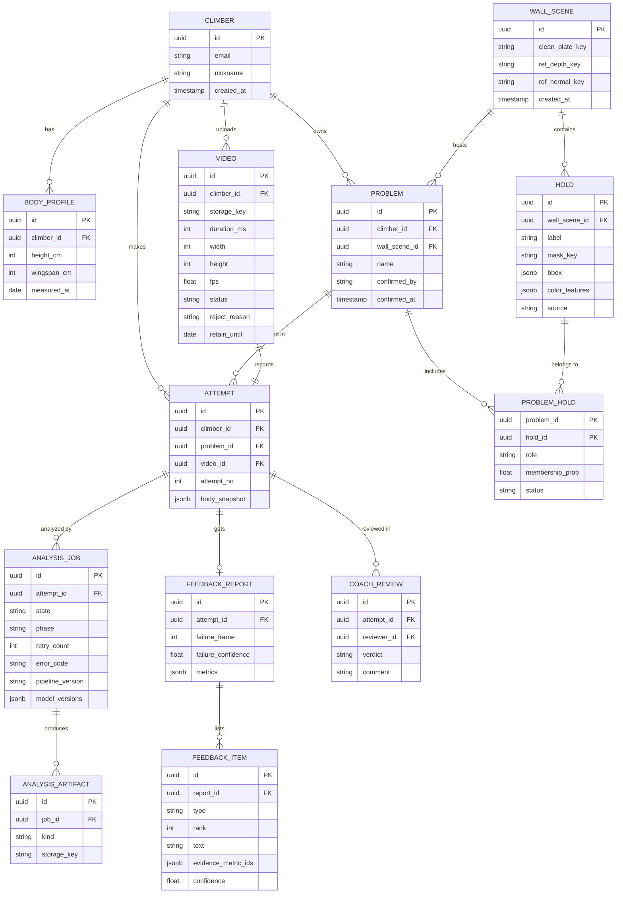

# ERD

> 🗂️ 핵심은 문제(problem)와 시도(attempt)의 분리다. 한 문제에 여러 시도가 붙고, 벽 장면(wall_scene)의 깊이·홀드는 같은 촬영 위치의 시도끼리 재사용된다. 대용량 산출물은 DB가 아닌 스토리지 키로만 참조한다.

## ERD

## 테이블 설명

| 테이블 | 역할 | 주요 규칙 |
| --- | --- | --- |
| climber | 회원 | 코치도 같은 테이블, 역할은 별도 권한으로 구분 |
| body_profile | 키·윙스팬 이력 | 수정 시 새 행 추가, 분석은 attempt.body_snapshot을 사용 |
| video | 원본 영상 메타데이터 | status: UPLOADED / VALIDATED / REJECTED, retain_until 이후 원본 삭제 |
| wall_scene | 촬영 위치 하나의 벽 기준 이미지·깊이 | 카메라 위치가 바뀌면 새 행 |
| hold | 벽 장면 안의 홀드 | source: AUTO / USER, 마스크는 스토리지 키 |
| problem | 사용자가 확정한 문제 | confirmed_by: USER / AUTO, 확정 전에는 분석 불가 |
| problem_hold | 문제-홀드 소속 | role: START / MIDDLE / FINISH, status: CONFIRMED / PENDING / EXCLUDED |
| attempt | 시도 한 번 | problem_id는 홀드 확정 전까지 비어 있을 수 있음, 같은 problem 안에서 attempt_no 증가 |
| analysis_job | 분석 상태 머신 | state는 기능 명세서의 상태 머신만 허용, retry_count 최대 2 |
| analysis_artifact | 단계별 산출물 참조 | kind: KEYFRAMES / DEPTH / POSE / MASKS / METRICS |
| feedback_report / feedback_item | 리포트와 개별 문장 | type: CAUSE / NEXT_MOVE, 문장마다 evidence_metric_ids 1개 이상 |
| coach_review | 코치 검토 | verdict: AGREE / PARTIAL / DISAGREE, 자동 결과를 덮어쓰지 않음 |

## 인덱스·제약

- attempt(problem_id, attempt_no) 유니크: 같은 문제의 시도 순번 중복 방지
- analysis_job(attempt_id, state): 진행 중 작업 조회
- video(retain_until): 보관 기한 만료 배치 삭제
- problem_hold(hold_id): 홀드가 속한 문제 역조회
- 모든 FK는 삭제 시 회원 단위 일괄 삭제를 지원(개인정보 삭제 요청 대응)
