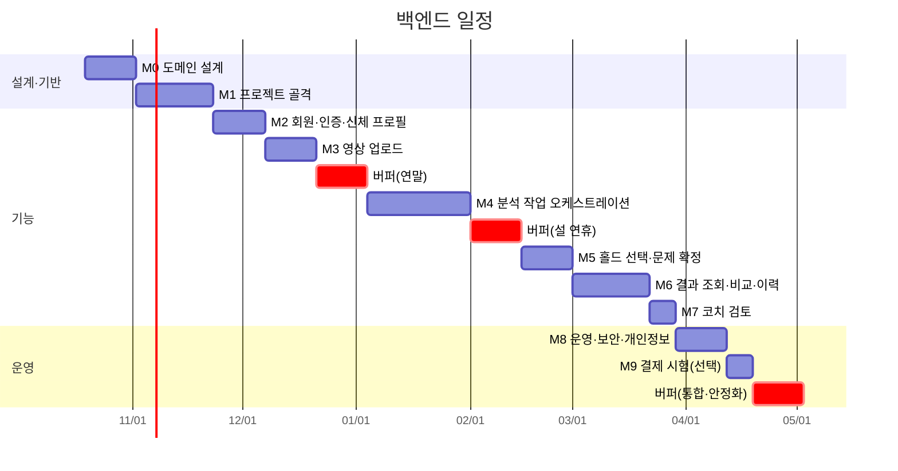

# 백엔드 WBS

> 🗓️ 백엔드(Spring Boot) 작업을 2026-10-19(월)부터 28주 일정으로 나눈다. 빨리 끝내는 것보다 도메인 설계와 테스트를 제대로 하는 것이 목표라서, 작업마다 여유를 두고 연휴·통합 시점에 버퍼 주간을 따로 잡았다.

관련 문서: [요구사항 정의서](01_요구사항_정의서.md) · [기능 명세서](02_기능_명세서.md) · [시스템 아키텍처](03_시스템_아키텍처.md) · [ERD](04_ERD.md) · [WBS(전체 8주 계획)](05_WBS.md) · [개발 컨벤션](CONVENTION.md)

## 일정 원칙

- **작업 기간은 예상치의 1.5배로 잡는다.** 처음 해 보는 작업(상태 머신, Redis Streams, SSE)은 2배로 잡는다.
- **버퍼 주간은 새 작업을 넣지 않는다.** 밀린 작업, 리팩터링, 테스트 보강, 문서 정리에만 쓴다. 남으면 다음 마일스톤을 당겨 시작한다.
- **마일스톤은 완료 기준을 통과해야 닫는다.** 날짜가 되어도 기준을 못 넘기면 버퍼를 쓰고, 버퍼도 넘기면 뒤 일정을 미룬다.
- **AI 워커를 기다리지 않는다.** 메시지 계약대로 응답하는 가짜 워커(stub)로 개발·테스트하고, 실제 워커는 준비되는 시점에 붙인다.
- **WBS 항목 하나가 GitHub 이슈 하나다.** 컨벤션대로 이슈 → 브랜치 → PR로 진행한다. 큰 항목은 하위 이슈로 쪼갠다.

## 마일스톤

| 주차 | 기간 | 마일스톤 | 완료 기준 |
| --- | --- | --- | --- |
| 1\~2 | 10/19 \~ 10/30 | **M0 도메인 설계** | 바운디드 컨텍스트·애그리거트·용어집 확정, 주요 결정 ADR 작성 |
| 3\~5 | 11/02 \~ 11/20 | **M1 프로젝트 골격** (MK-8) | `docker compose up` 한 번으로 로컬 실행, CI에서 빌드·테스트·아키텍처 규칙 검사 통과 |
| 6\~7 | 11/23 \~ 12/04 | **M2 회원·인증·신체 프로필** | FR-01 API 동작, 본인 자원만 접근 가능 |
| 8\~9 | 12/07 \~ 12/18 | **M3 영상 업로드** | presigned URL로 업로드 후 완료 알림까지 통과 |
| 10\~11 | 12/21 \~ 01/01 | 🟨 **버퍼** (연말) | |
| 12\~15 | 01/04 \~ 01/29 | **M4 분석 작업 오케스트레이션** | 가짜 워커로 REQUESTED → COMPLETED/FAILED/REJECTED 전 경로 통과, 중복 이벤트·워커 중단 시나리오 테스트 통과 |
| 16\~17 | 02/01 \~ 02/12 | 🟨 **버퍼** (설 연휴 2/6\~2/9) | |
| 18\~19 | 02/15 \~ 02/26 | **M5 홀드 선택·문제 확정** | 홀드 탭 → 확인 → 문제 확정 → 재시도 시 AWAITING 상태 건너뜀 |
| 20\~22 | 03/01 \~ 03/19 | **M6 결과 조회·비교·이력** | 리포트·오버레이·시도 비교·이력 API 동작 |
| 23 | 03/22 \~ 03/26 | **M7 코치 검토** | 코치 권한으로 검토 등록, 자동 결과는 그대로 유지 |
| 24\~25 | 03/29 \~ 04/09 | **M8 운영·보안·개인정보** | 보관 기한 삭제 배치, 회원 단위 삭제, 단계별 메트릭 수집 |
| 26 | 04/12 \~ 04/16 | **M9 결제 시험** (선택) | 무료 한도 초과 시 분석 요청 차단 |
| 27\~28 | 04/19 \~ 04/30 | 🟨 **버퍼** (통합·안정화) | 실제 워커로 영상 1편이 업로드부터 리포트까지 통과 |

28주 중 버퍼 주간이 6주(약 21%)이고, 작업 기간 안의 여유(1.5\~2배)는 별도다.

## 작업 분해

| WBS | 작업 | 주차 | 관련 요구사항 | 산출물 |
| --- | --- | --- | --- | --- |
| **0** | **M0 도메인 설계** | **1\~2** | | |
| 0.1 | 이벤트 스토밍: 업로드 → 홀드 확정 → 분석 → 피드백 → 비교 흐름의 이벤트·커맨드 정리 | 1 | 전체 | 이벤트 스토밍 결과 |
| 0.2 | 바운디드 컨텍스트와 컨텍스트 맵(회원, 영상, 벽·홀드, 문제, 분석, 피드백, 코치) | 1 | 전체 | 컨텍스트 맵 |
| 0.3 | 애그리거트 경계와 불변식 정리(Problem·Attempt 분리, AnalysisJob 상태 전이) | 2 | 전체 | 애그리거트 설계 문서 |
| 0.4 | 유비쿼터스 언어 용어집(한글·영문·코드명) | 1\~2 | 전체 | 용어집 |
| 0.5 | ADR: BE(Spring Boot)·AI(Python 워커) 분리, 인증 방식, 모듈 구조 | 2 | NFR-04 | ADR 문서 |
| 0.6 | API 명세 확정(요청·응답 스키마, 오류 코드) | 2 | 전체 | OpenAPI 초안 |
| **1** | **M1 프로젝트 골격 (MK-8)** | **3\~5** | | |
| 1.1 | Spring Boot 3·Java 21·Gradle 프로젝트 생성, 모듈별 패키지 구조(헥사고날) | 3 | NFR-04 | 프로젝트 골격 |
| 1.2 | 아키텍처 규칙 테스트(ArchUnit 또는 Spring Modulith): 도메인 → 인프라 의존 금지, 모듈 간 경계 | 3 | NFR-04 | 아키텍처 테스트 |
| 1.3 | Docker Compose: PostgreSQL, Redis, MinIO | 3\~4 | | `compose.yaml` |
| 1.4 | Flyway 마이그레이션, ERD 기준 초기 스키마 | 4 | | 마이그레이션 스크립트 |
| 1.5 | 공통 기반: 오류 응답 형식, Idempotency-Key 처리, 요청 로깅 | 4\~5 | NFR-03 | 공통 모듈 |
| 1.6 | 테스트 기반: Testcontainers 통합 테스트 설정 | 4\~5 | | 테스트 설정 |
| 1.7 | CI(GitHub Actions): 빌드, 테스트, 아키텍처 규칙 검사 | 5 | | 워크플로 |
| **2** | **M2 회원·인증·신체 프로필** | **6\~7** | | |
| 2.1 | 회원 가입·로그인(0.5에서 정한 방식) | 6 | NFR-07 | 인증 API |
| 2.2 | 자원 소유자 검사(본인 영상·리포트만 접근) | 6\~7 | NFR-07 | 접근 제어 |
| 2.3 | 신체 프로필 등록·수정(이력 보존) | 7 | FR-01 | `PUT /v1/me/body-profile` |
| 2.4 | 분석 동의·학습 활용 동의 분리 저장 | 7 | NFR-08 | 동의 기록 |
| **3** | **M3 영상 업로드** | **8\~9** | | |
| 3.1 | 스토리지 포트·MinIO 어댑터, presigned PUT URL 발급(짧은 만료) | 8 | FR-02, NFR-07 | `POST /v1/videos/upload-url` |
| 3.2 | 업로드 완료 알림, 영상 메타데이터 저장 | 8\~9 | FR-02 | `POST /v1/videos/{id}/complete` |
| 3.3 | 시도(Attempt) 생성, 보관 기한(retain_until) 설정 | 9 | FR-02, NFR-08 | `POST /v1/attempts` |
| **4** | **M4 분석 작업 오케스트레이션** | **12\~15** | | |
| 4.1 | 워커 메시지 계약을 JSON Schema로 고정(`RUN_PHASE`, `PROGRESS`, `PHASE_COMPLETED`, `PHASE_FAILED`) | 12 | NFR-05 | 스키마 파일 |
| 4.2 | AnalysisJob 애그리거트와 상태 머신(허용 전이만 통과) | 12\~13 | FR-12 | 상태 머신·단위 테스트 |
| 4.3 | 작업 큐 포트·Redis Streams 발행 어댑터(`analysis.jobs`) | 13 | | 발행 어댑터 |
| 4.4 | 이벤트 소비자(`analysis.events`): consumer group, PEL 회수, jobId+phase+attemptNo 중복 제거 | 13\~14 | NFR-03 | 소비 어댑터 |
| 4.5 | 실패 재시도(최대 2회)와 7일 무응답 EXPIRED 처리 | 14 | NFR-03 | 재시도·만료 배치 |
| 4.6 | 가짜 워커(stub): 계약대로 진행률·결과·실패 이벤트를 보냄 | 13\~14 | | 테스트용 워커 |
| 4.7 | 작업 상태 조회, SSE 진행 상황 | 14\~15 | FR-12 | `GET /v1/jobs/{id}`, `/events` |
| 4.8 | pipelineVersion·모델 식별자·산출물 키 저장 | 15 | NFR-05 | analysis_artifact 저장 |
| **5** | **M5 홀드 선택·문제 확정** | **18\~19** | | |
| 5.1 | WallScene·Hold 저장, 탐지 홀드 조회 | 18 | FR-04 | `GET /v1/jobs/{id}/holds` |
| 5.2 | 기준 홀드 탭 전달 → 작업 재개 | 18 | FR-05 | `POST .../hold-selection` |
| 5.3 | 홀드 추가·제외, 시작·종료 지정, Problem 확정 | 19 | FR-06, FR-07 | `POST .../hold-confirmation` |
| 5.4 | 같은 문제·같은 촬영 위치 재시도는 확정 홀드 재사용 | 19 | FR-06 | 재사용 로직 |
| **6** | **M6 결과 조회·비교·이력** | **20\~22** | | |
| 6.1 | 피드백 리포트 저장·조회(문장마다 근거 지표 1개 이상 검증) | 20 | FR-10, FR-11, NFR-06 | `GET .../report` |
| 6.2 | 오버레이 재생 데이터 조회(스토리지 키 → 단기 URL) | 20\~21 | FR-08 | `GET .../overlay` |
| 6.3 | 두 시도 비교(같은 Problem·WallScene만 허용) | 21\~22 | FR-13 | `GET .../comparison` |
| 6.4 | 문제별·날짜별 분석 이력 | 22 | FR-15 | 이력 API |
| **7** | **M7 코치 검토** | **23** | | |
| 7.1 | 코치 역할 권한 | 23 | FR-14 | 권한 설정 |
| 7.2 | 코치 검토 등록(자동 결과와 별도 기록) | 23 | FR-14 | `POST .../coach-reviews` |
| **8** | **M8 운영·보안·개인정보** | **24\~25** | | |
| 8.1 | 보관 기한 만료 원본 삭제 배치, 스토리지 수명 주기 정책 | 24 | NFR-08 | 삭제 배치 |
| 8.2 | 회원 탈퇴·삭제 요청 시 산출물까지 일괄 삭제 | 24\~25 | NFR-08 | 삭제 API |
| 8.3 | 단계별 처리 시간·실패 사유·반려 사유 메트릭 | 25 | NFR-01, NFR-09 | 메트릭 수집 |
| 8.4 | 보안 점검(접근 제어, presigned URL 만료, 내부망 전용 스트림) | 25 | NFR-07 | 점검 결과 |
| **9** | **M9 결제 시험 (선택)** | **26** | | |
| 9.1 | 무료 분석 횟수 한도 | 26 | FR-16 | 한도 검사 |
| 9.2 | 분석권 결제 시험 연동 | 26 | FR-16 | 결제 시험 |
| **B** | **버퍼 (통합·안정화)** | **27\~28** | | |
| B.1 | 실제 Python 워커와 종단 간 통합 테스트 | 27\~28 | 전체 | 통합 테스트 결과 |
| B.2 | 밀린 작업 처리, 문서·API 명세 최신화 | 27\~28 | | 최신 문서 |

## AI 워커 트랙과의 관계

- [WBS(전체 8주 계획)](05_WBS.md)는 팀 전체 일정이고, 이 문서는 그중 백엔드 트랙을 여유 있게 다시 잡은 것이다. 두 일정이 다르면 백엔드는 이 문서를 따른다.
- 백엔드가 워커에 의존하는 지점은 **메시지 계약(4.1)** 하나다. 계약은 M4 시작 전에 AI 트랙과 합의하고, 바뀌면 스키마 파일부터 고친다.
- 실제 워커 연동은 워커가 준비되는 대로 붙이되, 늦어지면 B.1에서 몰아서 한다. 그 전까지는 가짜 워커(4.6)로 모든 흐름을 검증한다.

## 리스크

| 리스크 | 대응 |
| --- | --- |
| 상태 머신·Redis Streams가 예상보다 복잡함 | M4에 4주를 잡고 바로 뒤에 버퍼 2주를 둠 |
| 인증 방식 결정 지연 | M0의 ADR(0.5)에서 확정, 늦어지면 이메일 로그인으로 먼저 진행 |
| 메시지 계약이 AI 트랙에서 자주 바뀜 | JSON Schema를 양쪽 저장소의 기준으로 두고, 바뀌면 이슈로 공유 |
| 워커 준비 지연 | 가짜 워커로 기능 개발을 끝내고, 통합은 마지막 버퍼에서 |
| DDD 경계를 잘못 잡아 중간에 재설계 | M0에 2주를 쓰고, M1에서 아키텍처 규칙 테스트로 경계를 강제 |
