# 이벤트 스토밍

> 🟧 업로드부터 시도 비교까지 사용자 흐름을 커맨드(누가 무엇을 요청하는가), 도메인 이벤트(무엇이 일어났는가), 정책(이벤트가 일어나면 무엇을 하는가)으로 나눈다. WBS 0.1의 산출물이다.

관련 문서: [기능 명세서](../02_기능_명세서.md) · [컨텍스트 맵](02_컨텍스트_맵.md) · [애그리거트](03_애그리거트.md) · [용어집](04_용어집.md)

## 표기

| 표기 | 의미 | 예 |
| --- | --- | --- |
| 🧑 액터 | 커맨드를 보내는 주체 | 클라이머, 코치, 워커, 스케줄러 |
| 🟦 커맨드 | 상태를 바꾸려는 요청 | 업로드 URL 발급 |
| 🟨 애그리거트 | 커맨드를 받아 규칙을 검사하는 대상 | Video |
| 🟧 이벤트 | 일어난 사실(과거형) | VideoUploaded |
| 🟪 정책 | "이벤트가 일어나면 ~한다" | 업로드되면 분석을 요청한다 |

## 전체 흐름

```mermaid
flowchart LR
    subgraph 가입
        A1["ClimberRegistered"] --> A2["BodyProfileRecorded"]
    end
    subgraph 업로드
        B1["UploadUrlIssued"] --> B2["VideoUploaded"] --> B3["AttemptCreated"] --> B4["AnalysisRequested"]
    end
    subgraph 전처리
        C1["PreprocessDispatched"] --> C2{"P0 검증"}
        C2 -->|부적합| C3["AnalysisRejected"]
        C2 --> C4["HoldsDetected"]
    end
    subgraph 문제 확정
        D1["ReferenceHoldSelected"] --> D2["ProblemInferred"]
        D2 -->|저확신 홀드| D3["HoldConfirmationRequested"] --> D4["ProblemConfirmed"]
        D2 -->|확신도 충분| D4
    end
    subgraph 분석
        E1["AnalyzeDispatched"] --> E2["AnalysisCompleted"] --> E3["FeedbackReportCreated"]
    end
    subgraph 활용
        F1["CoachReviewSubmitted"]
        F2["시도 비교·이력 조회"]
    end
    A2 --> B1
    B4 --> C1
    C4 --> D1
    D4 --> E1
    E3 --> F1
    E3 --> F2
```

같은 문제·같은 촬영 위치의 재시도는 `AttemptCreated` 다음에 확정된 홀드를 재사용해 **문제 확정 단계를 건너뛰고** 바로 분석으로 간다.

## 단계별 상세

### 1. 가입·신체 프로필 (FR-01, NFR-08)

| 액터 | 커맨드 | 애그리거트 | 이벤트 | 정책 |
| --- | --- | --- | --- | --- |
| 클라이머 | 소셜 로그인 | Climber | ClimberRegistered (처음일 때) | |
| 클라이머 | 동의 저장 (분석 / 학습 활용 분리) | Climber | ConsentGiven, ConsentWithdrawn | 분석 동의가 없으면 업로드 URL을 발급하지 않는다 |
| 클라이머 | 신체 프로필 등록·수정 | BodyProfile | BodyProfileRecorded | 수정은 새 행 추가, 과거 시도에는 영향 없음 |
| 클라이머 | 회원 탈퇴 | Climber | ClimberWithdrawn | 탈퇴하면 각 도메인이 자기 데이터와 스토리지 산출물을 삭제한다 |

### 2. 업로드·시도 생성 (FR-02)

| 액터 | 커맨드 | 애그리거트 | 이벤트 | 정책 |
| --- | --- | --- | --- | --- |
| 클라이머 | 업로드 URL 발급 | Video | UploadUrlIssued | |
| 클라이머 | 업로드 완료 알림 | Video | VideoUploaded | |
| 클라이머 | 시도 생성 + 분석 요청 (problemId 선택) | Attempt, AnalysisJob | AttemptCreated, AnalysisRequested | 신체 프로필을 시도에 스냅샷으로 복사한다 |
| 스케줄러 | 업로드 미완료 정리 | Video | UploadAbandoned | 발급 후 24시간 안에 완료 알림이 없으면 정리한다 |

### 3. 전처리·홀드 탐지 (FR-03, FR-04)

| 액터 | 커맨드 | 애그리거트 | 이벤트 | 정책 |
| --- | --- | --- | --- | --- |
| 시스템 | 전처리 단계 발행 | AnalysisJob | PreprocessDispatched | AnalysisRequested가 일어나면 전처리 작업을 큐에 넣는다 |
| 워커 | 진행률 보고 | AnalysisJob | ProgressReported | 진행률은 SSE로 내보낸다 |
| 워커 | 전처리 실패: 입력 부적합 | AnalysisJob, Video | AnalysisRejected, VideoRejected | 반려 사유와 재촬영 가이드를 보여준다. 재시도하지 않는다 |
| 워커 | 전처리 완료 | AnalysisJob, WallScene | HoldsDetected, WallSceneCreated | 새 촬영 위치면 WallScene을 만들고 홀드를 등록한 뒤 사용자 입력을 기다린다 |
| 워커 | 처리 오류 | AnalysisJob | AnalysisFailed | 실행 회차가 2회 미만이면 같은 단계를 다시 발행한다 |

### 4. 문제 확정 (FR-05 \~ FR-07)

| 액터 | 커맨드 | 애그리거트 | 이벤트 | 정책 |
| --- | --- | --- | --- | --- |
| 클라이머 | 기준 홀드 선택 | AnalysisJob | ReferenceHoldSelected | 선택되면 문제 소속 추정 작업을 큐에 넣는다 |
| 클라이머 | 누락 홀드 추가 (탭) | WallScene | HoldAdded | SAM 2 영역 분리가 필요하다 (응답 방식은 [ADR-0004](../adr/0004-분석-단계와-메시지-계약.md)) |
| 워커 | 문제 소속 추정 완료 | AnalysisJob, Problem | ProblemInferred | 저확신 홀드가 있으면 확인을 요청하고, 없으면 문제를 확정한다 |
| 클라이머 | 홀드 추가·제외, 시작·종료 지정 | Problem | ProblemConfirmed | 확정되면 시도에 문제를 연결하고 분석 작업을 큐에 넣는다 |
| 스케줄러 | 응답 대기 만료 | AnalysisJob | AnalysisExpired | 사용자 입력 대기가 7일을 넘으면 만료한다 |

### 5. 분석·피드백 (FR-08 \~ FR-12)

| 액터 | 커맨드 | 애그리거트 | 이벤트 | 정책 |
| --- | --- | --- | --- | --- |
| 시스템 | 분석 단계 발행 | AnalysisJob | AnalyzeDispatched | ProblemConfirmed가 일어나거나 재시도의 홀드가 이미 확정돼 있으면 발행한다 |
| 워커 | 분석 완료 | AnalysisJob | AnalysisCompleted | 산출물 키·pipelineVersion·모델 식별자를 저장하고 리포트를 만든다 |
| 시스템 | 리포트 생성 | FeedbackReport | FeedbackReportCreated | 근거 지표가 없는 문장은 거부한다 |

### 6. 활용 (FR-13 \~ FR-15)

| 액터 | 커맨드 | 애그리거트 | 이벤트 | 정책 |
| --- | --- | --- | --- | --- |
| 코치 | 코치 검토 등록 | CoachReview | CoachReviewSubmitted | 자동 리포트는 바꾸지 않는다 |
| 클라이머 | 두 시도 비교 (조회) | | | 같은 Problem·같은 WallScene일 때만 허용 |
| 클라이머 | 분석 이력 (조회) | | | |

### 7. 운영 (NFR-08)

| 액터 | 커맨드 | 애그리거트 | 이벤트 | 정책 |
| --- | --- | --- | --- | --- |
| 스케줄러 | 보관 기한 만료 처리 | Video | VideoRetentionExpired | 원본 영상만 지우고 분석 결과는 남긴다 |

## 핫스팟 (결정이 필요한 곳)

이벤트 스토밍 중 기존 문서로 답이 나지 않은 곳이다. 각 항목의 결정은 링크한 문서에 있다.

| # | 핫스팟 | 결정 |
| --- | --- | --- |
| H1 | 워커 메시지의 `attemptNo`(작업 재실행 회차)와 등반 시도 `Attempt.attemptNo`(같은 문제의 몇 번째 시도)가 이름이 같다 | 작업 쪽을 `runNo`로 바꾼다 → [ADR-0004](../adr/0004-분석-단계와-메시지-계약.md) |
| H2 | 기능 명세서의 메시지 예시는 분석 결과를 `PHASE_2`로 보내는데, 상태 머신에는 전처리·문제 추정·분석 세 단계가 있다 | 단계 이름을 `PREPROCESS`, `INFER_PROBLEM`, `ANALYZE`로 정한다 → [ADR-0004](../adr/0004-분석-단계와-메시지-계약.md) |
| H3 | 상태 머신에 `INFERRING_PROBLEM → FAILED`, `AWAITING_CONFIRMATION → EXPIRED` 전이가 없다 | 추가한다 → [애그리거트](03_애그리거트.md#analysisjob) |
| H4 | 누락 홀드 탭(FR-07)은 즉시 응답이 필요한데 분석 큐는 몇 분짜리 작업이 앞에 있을 수 있다 | 별도 우선순위 스트림으로 보낸다 → [ADR-0004](../adr/0004-분석-단계와-메시지-계약.md) |
| H5 | 카카오 로그인은 이메일 제공이 선택 동의라 ERD의 `climber.email`을 신원으로 쓸 수 없다 | 소셜 계정 식별자로 신원을 잡는다 → [ADR-0003](../adr/0003-인증-소셜-로그인-JWT.md) |
| H6 | 업로드 URL을 발급한 뒤 업로드하지 않은 영상의 상태가 ERD에 없다 | `video.status`에 `PENDING`을 추가한다 → [애그리거트](03_애그리거트.md#video) |
| H7 | 회원 탈퇴 시 모든 도메인 데이터를 지워야 하는데, `member`는 가장 아래 도메인이라 위쪽 도메인을 호출할 수 없다 | 도메인 이벤트로 알린다 → [컨텍스트 맵](02_컨텍스트_맵.md#역방향-알림은-도메인-이벤트로) |
