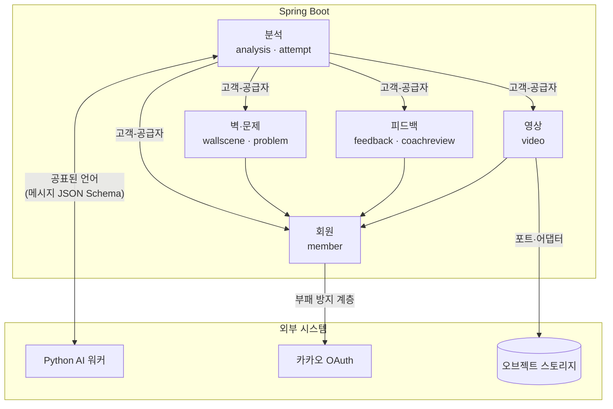
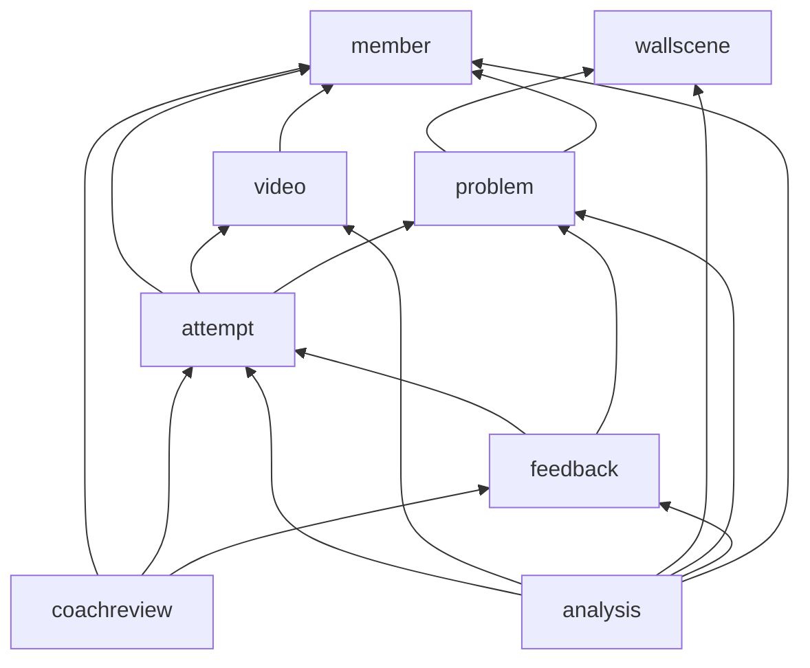

# 컨텍스트 맵

> 🗺️ 백엔드를 5개 바운디드 컨텍스트, 8개 도메인 패키지로 나누고, 도메인 간 의존을 한 방향으로 고정한다. 분석(analysis)이 흐름을 조율하는 최상위 도메인이고, 회원(member)이 가장 아래에 있다. WBS 0.2의 산출물이다.

관련 문서: [이벤트 스토밍](01_이벤트_스토밍.md) · [애그리거트](03_애그리거트.md) · [코드 컨벤션](../CODE_CONVENTION.md)

## 바운디드 컨텍스트

| 컨텍스트 | 도메인 패키지 | 분류 | 책임 |
| --- | --- | --- | --- |
| **분석** | `analysis`, `attempt` | 핵심 | 시도 생성, 분석 작업 상태 머신, 워커와의 메시지 송수신, 사용자 입력 대기·재개 |
| **벽·문제** | `wallscene`, `problem` | 핵심 | 촬영 위치별 벽 기준 이미지와 홀드, 사용자가 확정한 문제와 홀드 소속 |
| **피드백** | `feedback`, `coachreview` | 지원 | 리포트·피드백 문장 저장, 시도 비교, 코치 검토 |
| **영상** | `video` | 지원 | 업로드 URL, 영상 메타데이터, 보관 기한 |
| **회원** | `member` | 일반 | 소셜 로그인, 토큰, 신체 프로필, 동의, 역할(클라이머·코치) |

핵심 도메인은 "확신도 낮은 것은 사용자에게 묻고 멈췄다 재개하는 분석 흐름"과 "사용자와 함께 문제를 확정하는 규칙"이다. 설계 시간과 테스트는 이 두 곳에 가장 많이 쓴다.

## 맵

| 관계 | 패턴 | 설명 |
| --- | --- | --- |
| 분석 ↔ AI 워커 | 공표된 언어 + 부패 방지 계층 | 메시지 형식은 JSON Schema 파일로 고정하고 양쪽이 같은 파일로 검증한다. 워커 이벤트는 `analysis/infra`의 소비자가 받아 도메인 커맨드로 번역한다. 모델 이름은 `modelVersions`에 문자열로 저장만 하고 도메인 규칙에 쓰지 않는다 |
| 회원 → 카카오 | 부패 방지 계층 | 카카오 사용자 정보는 `member/infra` 어댑터에서 `SocialProfile`로 바꾼 뒤에만 도메인에 들어온다 |
| 분석 → 나머지 | 고객-공급자 | 분석 UseCase가 다른 도메인의 `domain/service`를 호출한다. 공급자 쪽은 분석이 필요한 연산만 서비스로 공개한다 |

## 도메인 간 의존 방향

코드 컨벤션의 규칙(쓰는 도메인 → 제공하는 도메인, 순환 금지)을 패키지 단위로 고정한다. 아래 화살표 외의 의존은 금지하고, M1에서 ArchUnit으로 검사한다.

### UseCase 배치

여러 도메인을 넘나드는 시나리오는 의존 그래프에서 **가장 위에 있는 도메인**에 둔다.

| 시나리오 | 위치 | 이유 |
| --- | --- | --- |
| 시도 생성 + 분석 요청 (`POST /v1/attempts`) | `analysis` | Attempt와 AnalysisJob을 함께 만든다 |
| 기준 홀드 선택, 홀드 확인·문제 확정 | `analysis` | 작업 재개, Problem 확정, Attempt 연결이 한 흐름이다 |
| 워커 이벤트 처리 | `analysis` | WallScene·Hold 등록, Video 반려, 리포트 생성을 함께 한다 |
| 작업 상태·SSE·오버레이 조회 | `analysis` | 작업과 산출물 키를 가진다 |
| 분석 이력 (`FR-15`) | `analysis` | 시도·작업 상태·리포트 요약을 함께 보여준다 |
| 리포트 조회, 두 시도 비교 | `feedback` | 리포트 지표만 쓰고, 같은 문제·촬영 위치인지는 `attempt`·`problem`에 묻는다 |
| 코치 검토 등록 | `coachreview` | 리포트가 있는지 `feedback`에 묻는다 |

### 역방향 알림은 도메인 이벤트로

아래 도메인이 위 도메인에 무언가를 알려야 할 때(예: 회원 탈퇴 → 모든 도메인의 데이터 삭제)는 직접 호출하지 않고 **도메인 이벤트**를 발행한다.

- `member`가 `ClimberWithdrawn`을 발행하면 각 도메인의 리스너가 자기 데이터와 스토리지 산출물을 지운다.
- 이벤트 클래스는 발행하는 도메인의 `domain/entity`(또는 `domain/event`)에 두므로, 리스너 쪽 의존 방향(위 → 아래)은 그대로 지켜진다.
- 구현은 Spring `ApplicationEventPublisher`와 `@TransactionalEventListener(phase = AFTER_COMMIT)`로 시작한다. 삭제가 중간에 실패하면 다시 처리해야 하므로, 삭제 요청은 상태를 가진 레코드로 남기고 배치가 끝까지 처리한다(M8에서 구체화).

## 공유하는 것과 공유하지 않는 것

- **공유한다:** ID 값 타입(`ClimberId`, `AttemptId` 등), `global/` 공통 모듈.
- **공유하지 않는다:** 다른 도메인의 엔티티·리포지토리. 필요한 값은 공급자 도메인의 `domain/service`가 돌려주는 값 객체로 받는다.
- **DB 외래 키:** 같은 DB를 쓰므로 ERD의 FK는 유지한다. 다만 JPA 연관관계(`@ManyToOne` 등)는 **같은 애그리거트 안에서만** 쓰고, 다른 애그리거트는 ID로만 참조한다.
