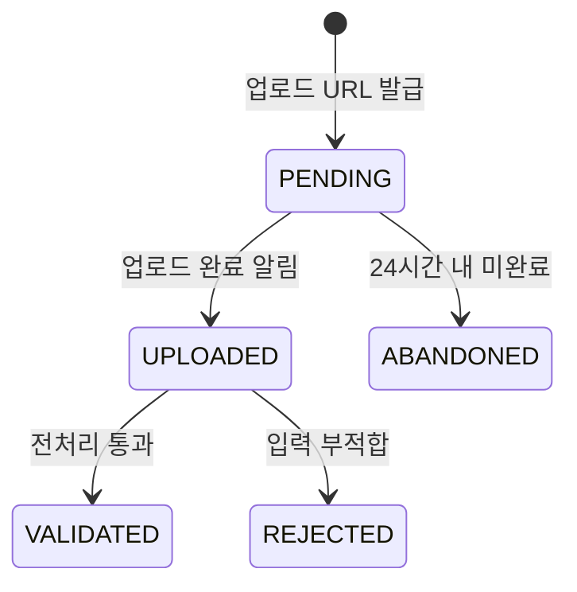
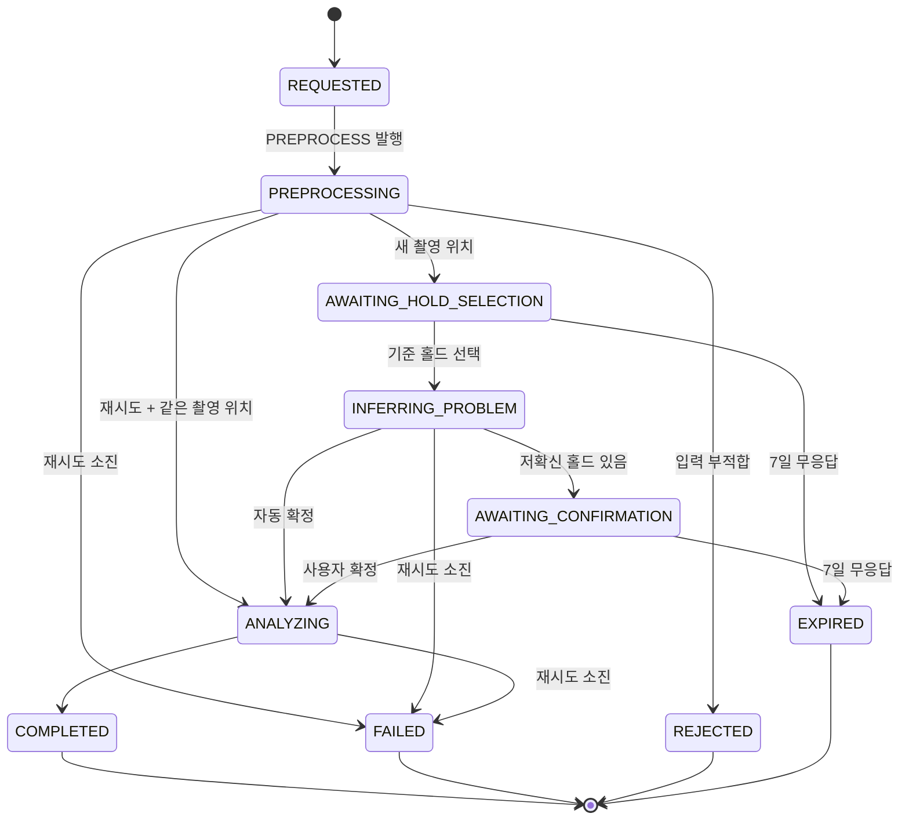

# 애그리거트와 불변식

> 🧱 애그리거트는 "한 트랜잭션에서 함께 바뀌어야 하는 것"의 경계다. 다른 애그리거트는 ID로만 참조하고, 여러 애그리거트를 바꾸는 흐름은 UseCase가 조율한다. 불변식은 엔티티 메서드 안에서 검사해 깨진 상태로 저장될 수 없게 한다. WBS 0.3의 산출물이다.

관련 문서: [ERD](../04_ERD.md) · [기능 명세서](../02_기능_명세서.md) · [컨텍스트 맵](02_컨텍스트_맵.md) · [용어집](04_용어집.md)

## 한눈에 보기

| 도메인 | 애그리거트 루트 | 내부 엔티티·값 객체 | ERD 테이블 |
| --- | --- | --- | --- |
| `member` | Climber | SocialAccount, Consent | climber |
| `member` | BodyProfile | | body_profile |
| `video` | Video | | video |
| `wallscene` | WallScene | Hold | wall_scene, hold |
| `problem` | Problem | ProblemHold | problem, problem_hold |
| `attempt` | Attempt | BodySnapshot | attempt |
| `analysis` | AnalysisJob | AnalysisArtifact | analysis_job, analysis_artifact |
| `feedback` | FeedbackReport | FeedbackItem | feedback_report, feedback_item |
| `coachreview` | CoachReview | | coach_review |

## member

### Climber

- **신원은 소셜 계정이다.** `(provider, providerUserId)`가 유일하고, 이메일은 없을 수 있다([ADR-0003](../adr/0003-인증-소셜-로그인-JWT.md)).
- **역할:** `CLIMBER`, `COACH`. 코치 지정은 관리자가 한다(MVP는 DB 직접 수정).
- **동의:** 분석 동의와 학습 활용 동의를 따로 기록하고, 각각 동의·철회 시각을 남긴다. 분석 동의가 없으면 업로드 URL을 발급하지 않는다.
- **상태:** `ACTIVE` → `WITHDRAWN`. 탈퇴하면 `ClimberWithdrawn` 이벤트를 발행하고, 개인 식별 정보(이메일, 닉네임, 소셜 ID)를 즉시 지운다.

### BodyProfile

- 키·윙스팬 한 번의 기록이다. **수정은 새 행 추가**이고, 기존 행은 바꾸지 않는다.
- 범위: 키 100\~250cm, 윙스팬 100\~280cm.
- 최신 기록이 현재 프로필이다. 분석은 시도 생성 시점의 값을 Attempt에 스냅샷으로 복사해서 쓴다.

## video

### Video

- **소유자만** 완료 알림을 보낼 수 있다.
- 완료 알림 때 스토리지에 객체가 실제로 있는지, 크기와 형식(mp4, mov)이 허용 범위인지 확인한다. 길이·해상도·흔들림은 워커가 P0에서 검사한다.
- `retainUntil`은 업로드 완료 시각 + 보관 기간(기간은 열린 질문, 설정값으로 둔다)이다. 기한이 지나면 원본 파일만 지우고 행은 남긴다.

## wallscene

### WallScene

- 촬영 위치 하나다. 카메라 위치가 바뀌면 새 WallScene이다.
- **Hold는 WallScene 안의 엔티티다.** 홀드는 벽 장면 없이 존재할 수 없고, 같은 장면 안에서 `label`이 유일하다.
- Hold의 `source`는 `AUTO`(워커 탐지) 또는 `USER`(탭으로 추가)다. 홀드는 지우지 않는다. 문제에서 빼는 것은 Problem의 일이다.
- 벽 기준 이미지·깊이·normal은 스토리지 키로만 가진다.

## problem

### Problem

- 클라이머 한 명이 확정한 문제다. 문제는 그 클라이머에게만 보인다(다른 사람과 공유는 MVP 범위 밖).
- **ProblemHold는 Problem 안의 엔티티다.** 역할은 `START`, `MIDDLE`, `FINISH`, 상태는 `CONFIRMED`, `PENDING`(보류), `EXCLUDED`다.
- 불변식:
  - 모든 홀드는 Problem의 WallScene에 속한 홀드여야 한다.
  - 확정하려면 `CONFIRMED` 상태의 `START`가 1개 이상, `FINISH`가 1개 이상 있어야 한다.
  - `PENDING`(보류) 홀드는 `START`·`FINISH`가 될 수 없다.
  - 확정 후에는 홀드 구성을 바꾸지 않는다(확정 후 수정은 MVP 범위 밖).
- `confirmedBy`는 `USER`(사용자가 확인) 또는 `AUTO`(저확신 홀드가 없어 자동 확정)다.

## attempt

### Attempt

- 등반 한 번이다. 영상 하나에 시도 하나(1:1)다.
- `problemId`와 `attemptNo`는 문제가 확정될 때 함께 채워진다. `attemptNo`는 같은 문제 안에서 1부터 증가하고, `(problemId, attemptNo)`가 유일하다. 동시에 두 시도가 같은 번호를 받으면 유일 제약으로 막고 다시 번호를 받는다.
- **BodySnapshot은 생성 시점에 복사하고 바꾸지 않는다.** 신체 프로필이 없으면 시도를 만들 수 없다.

## analysis

### AnalysisJob

시도 하나의 분석 작업이다. 상태 머신은 기능 명세서를 바탕으로 하되 아래 세 가지를 바꾼다(변경 이유는 [이벤트 스토밍 핫스팟](01_이벤트_스토밍.md#핫스팟-결정이-필요한-곳) H3).

1. **재시도는 같은 상태에서 다시 발행한다.** 기능 명세서의 `FAILED → REQUESTED`는 분석 단계에서 실패해도 전처리부터 다시 돌게 된다. 대신 실패한 단계를 같은 상태에서 `runNo`를 올려 다시 발행하고, 재시도를 다 쓰면 `FAILED`(종료)로 간다.
2. **`INFERRING_PROBLEM`에서도 실패할 수 있다.**
3. **`AWAITING_CONFIRMATION`도 7일 무응답이면 만료한다.**

- **상태별 실행 단계:** `PREPROCESSING`은 `PREPROCESS`(P0\~P2), `INFERRING_PROBLEM`은 `INFER_PROBLEM`(P3), `ANALYZING`은 `ANALYZE`(P4\~P7)를 실행한다.
- **재시도 예산:** 작업 전체에서 2회(`retryCount ≤ 2`). 재시도할 때마다 `runNo`를 1 올린다.
- **이벤트 수용 규칙:** 워커 이벤트는 `(jobId, phase, runNo)`가 **현재 실행 중인 단계·회차와 같을 때만** 반영한다. 지난 회차의 늦은 이벤트, 같은 완료 이벤트의 중복 수신은 무시한다. `PROGRESS`는 진행률이 지금보다 클 때만 반영한다.
- **같은 촬영 위치 판정:** 재시도(problemId 지정)라도 워커가 P1에서 기존 벽 기준 이미지와 비교해 촬영 위치가 다르다고 판단하면 새 촬영 위치처럼 `AWAITING_HOLD_SELECTION`으로 간다.
- **사용자 입력 대기 시작 시각**(`waitingSince`)을 저장해 7일 만료를 판단한다.
- **AnalysisArtifact는 AnalysisJob 안의 값이다.** 종류(`KEYFRAMES`, `DEPTH`, `POSE`, `MASKS`, `METRICS` 등)와 스토리지 키, 만든 단계를 가진다. 완료 시 `pipelineVersion`과 `modelVersions`를 함께 저장한다.

## feedback

### FeedbackReport

- 시도 하나에 리포트 하나(분석이 `COMPLETED`된 작업에서 만든다)이며 어느 작업에서 만들었는지 `jobId`를 가진다.
- **FeedbackItem은 FeedbackReport 안의 엔티티다.** 종류는 `CAUSE`(실패 원인 후보), `NEXT_MOVE`(다음 동작 후보)다.
- 불변식:
  - 모든 문장은 근거 지표 ID가 1개 이상이다(NFR-06).
  - `NEXT_MOVE`는 최대 3개이고, 같은 종류 안에서 `rank`가 겹치지 않는다.
  - `confidence`는 0\~1이다.
- 리포트는 만든 뒤 바꾸지 않는다. 코치 의견은 CoachReview에 따로 남긴다.

## coachreview

### CoachReview

- `COACH` 역할만 등록할 수 있고, 리포트가 있는 시도에만 등록할 수 있다.
- 코치 한 명은 시도 하나에 검토 하나를 남기고, 수정할 수 있다.
- `verdict`는 `AGREE`, `PARTIAL`, `DISAGREE`다.

## 공통 규칙

- **ID는 UUIDv7**이다([ADR-0005](../adr/0005-ID-UUIDv7.md)). 애그리거트를 만들 때 도메인에서 생성한다.
- **시각은 `Instant`(UTC)**로 저장한다.
- 다른 애그리거트는 ID 값 타입(`ClimberId`, `ProblemId` 등)으로만 참조하고, JPA 연관관계는 애그리거트 안에서만 쓴다.

## ERD 변경 제안

위 설계를 반영하려면 [ERD](../04_ERD.md)를 아래처럼 바꿔야 한다. 이 PR이 승인되면 ERD 문서에 반영한다.

| 테이블 | 변경 | 이유 |
| --- | --- | --- |
| climber | `provider`, `provider_user_id`(함께 유일), `role`, `status`, `withdrawn_at` 추가, `email`은 NULL 허용 | 소셜 로그인 신원, 코치 역할, 탈퇴 |
| consent (신규) | `climber_id`, `type`(ANALYSIS / TRAINING), `agreed_at`, `withdrawn_at` | 동의 분리 기록(NFR-08) |
| video | `status`에 `PENDING`, `ABANDONED` 추가, `content_type`, `size_bytes` 추가 | 업로드 전 상태, 완료 검증 |
| attempt | `attempt_no` NULL 허용(문제 확정 전), `video_id` 유일 | 문제 확정 시 번호 부여, 영상 1:1 |
| analysis_job | `run_no`, `waiting_since`, `progress` 추가, `phase` 값을 `PREPROCESS`/`INFER_PROBLEM`/`ANALYZE`로 | 이벤트 중복 제거, 만료 판단, 진행률 |
| analysis_artifact | `phase` 추가 | 어느 단계 산출물인지 |
| feedback_report | `job_id` 추가, `attempt_id` 유일 | 생성 작업 추적, 시도당 리포트 하나 |
| coach_review | `(attempt_id, reviewer_id)` 유일, `created_at`, `updated_at` 추가 | 코치당 검토 하나 |
